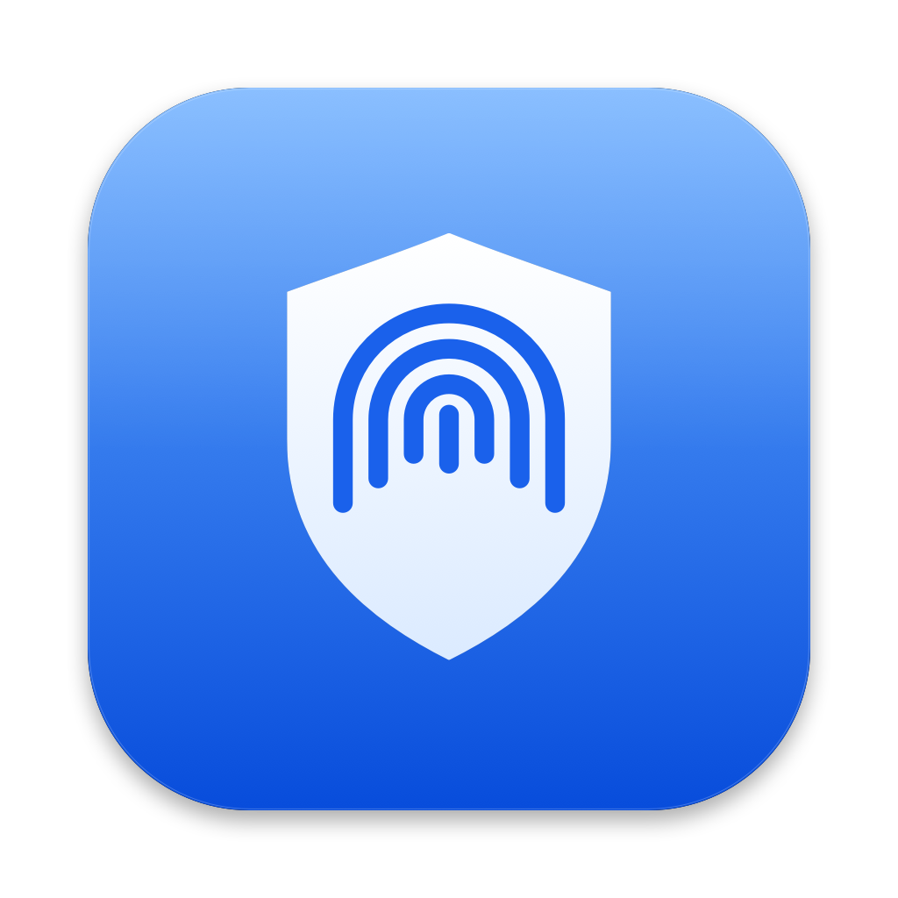
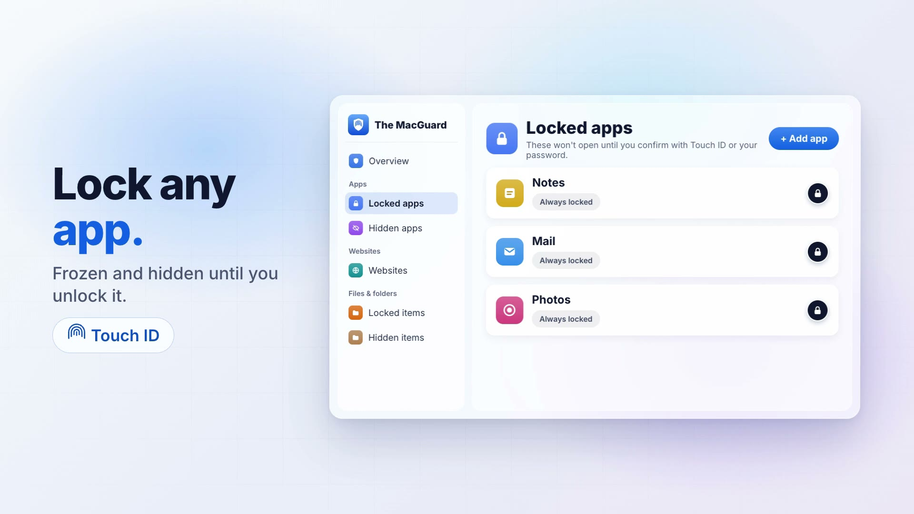
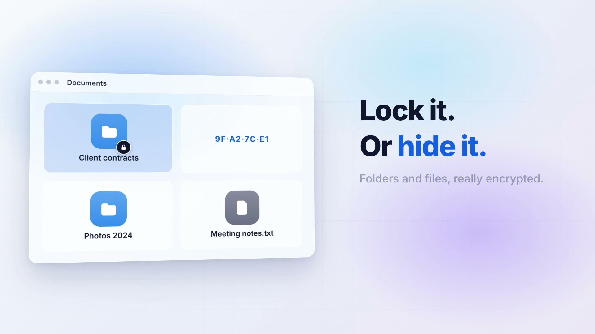
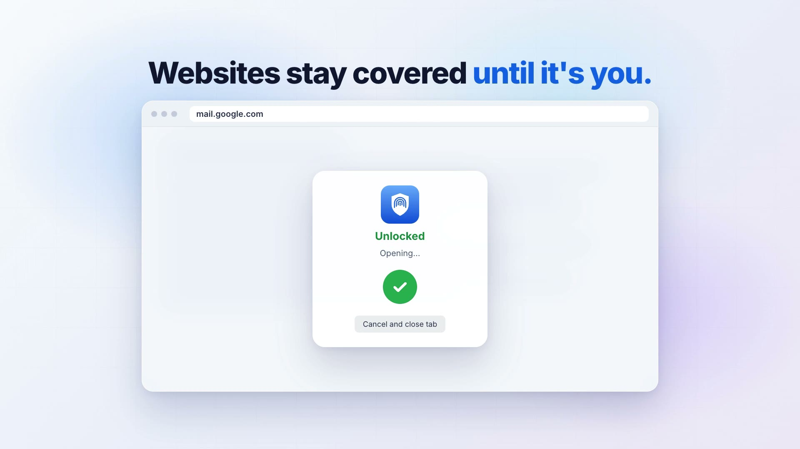
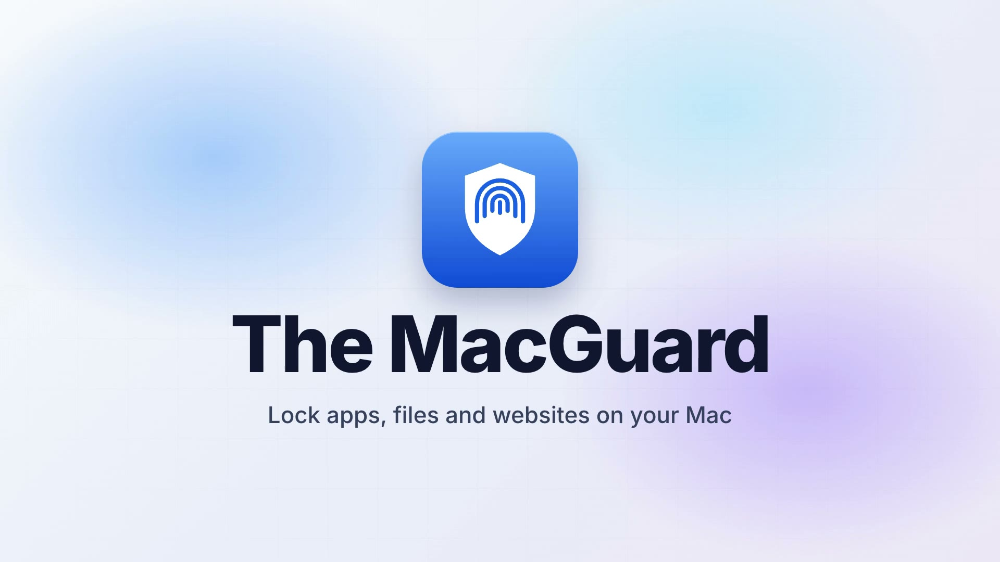
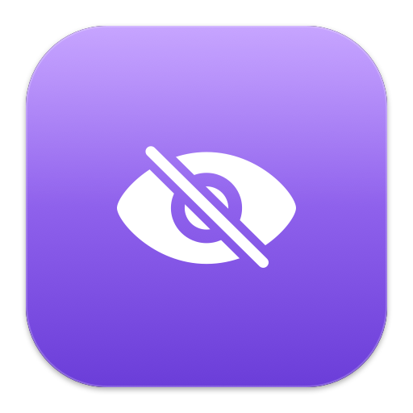
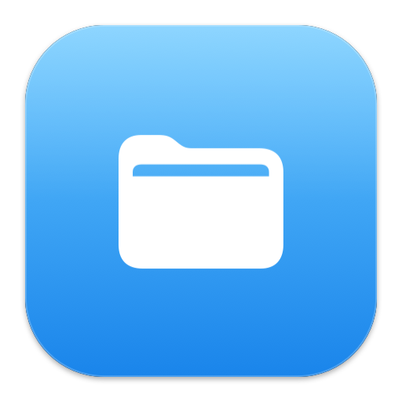
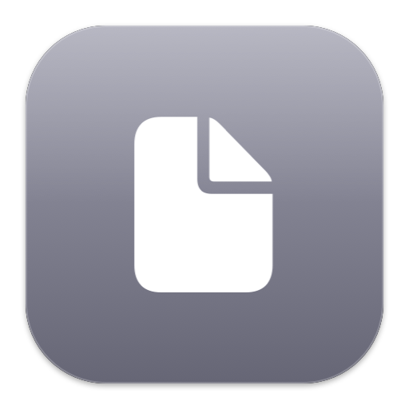
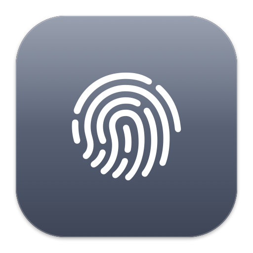
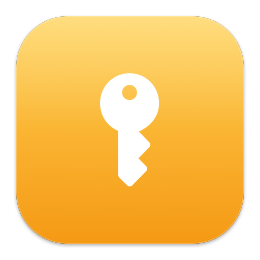

# The MacGuard

### Lock apps, files and websites on your Mac

The MacGuard lives in your menu bar. Choose what's private, and it stays locked behind Touch ID or a password. 
What you protect is encrypted on your Mac. No account. No server. Nothing leaves your device.

[Highlights](#highlights) &nbsp;·&nbsp; [A closer look](#a-closer-look) &nbsp;·&nbsp; [What you can protect](#what-you-can-protect) &nbsp;·&nbsp; [Install](#install) &nbsp;·&nbsp; [Getting started](#getting-started) &nbsp;·&nbsp; [Good to know](#good-to-know) &nbsp;·&nbsp; [Questions](#questions)

https://github.com/user-attachments/assets/0620995d-ac8b-4aba-9a90-00398d2edb6a

> [!NOTE]
> **The MacGuard is under development and closed source.** This page shows what it does. The app will be published soon.

 

## Highlights

<table>
  <tr>
    <td width="33%" valign="top"><b>🔒&nbsp; Lock any app</b> A locked app stays hidden until you unlock it. Open it and The MacGuard asks for Touch ID or your password first.</td>
    <td width="33%" valign="top"><b>🫥&nbsp; Hide apps, files and folders</b> Hidden items are encrypted and vanish from Finder and Applications. Bring them back exactly where they were.</td>
    <td width="33%" valign="top"><b>🌐&nbsp; Lock websites</b> Works in Safari, Chrome, Edge, Brave, Firefox and more. A locked site is covered until it's you.</td>
  </tr>
  <tr>
    <td valign="top"><b>👆&nbsp; Touch ID first</b> Unlock with your fingerprint. Add a password, or allow your Mac password, as a backup.</td>
    <td valign="top"><b>📸&nbsp; Intruder photos</b> Optionally take a photo of anyone who fails to unlock. Photos stay on your Mac.</td>
    <td valign="top"><b>🔑&nbsp; Recovery key</b> You get a one-time recovery key at setup. If you ever lose access, it gets you back in.</td>
  </tr>
</table>

## A closer look

<table>
  <tr>
    <td></td>
    <td></td>
  </tr>
  <tr align="center">
    <td><b>Lock any app</b> add it once, it stays locked</td>
    <td><b>Lock it, or hide it</b> folders and files, really encrypted</td>
  </tr>
  <tr>
    <td></td>
    <td></td>
  </tr>
  <tr align="center">
    <td><b>Cover private websites</b> unlock with Touch ID</td>
    <td><b>The MacGuard</b> lock apps, files and websites on your Mac</td>
  </tr>
</table>

These images are from the launch video. The apps, files and website shown are examples.

 

## What you can protect

<table>
  <tr>
    <td align="center"> <b>Apps</b> locked until you unlock</td>
    <td align="center"> <b>Hidden</b> gone from Finder</td>
    <td align="center"> <b>Folders</b> locked or hidden</td>
    <td align="center"> <b>Files</b> lock badge in place</td>
  </tr>
  <tr>
    <td align="center"> <b>Websites</b> covered until unlocked</td>
    <td align="center"> <b>Unlock</b> Touch ID or password</td>
    <td align="center"> <b>Intruders</b> optional photos</td>
    <td align="center"> <b>Recovery</b> one-time key</td>
  </tr>
</table>

 

## Install

> **Coming soon.** The MacGuard hasn't been released yet. These steps will apply once the first version is published.

1. Open the [**Releases**](../../releases) page and download the latest `TheMacGuard.dmg`.
2. Open the file and drag **The MacGuard** onto **Applications**.
3. Open **The MacGuard** from your Applications folder.

> **First time opening it:** macOS may say it can't check the app for malware. Right-click **The MacGuard** in Applications, choose **Open**, then click **Open** again. You only need to do this once.

## Getting started

1. **Set up.** The MacGuard asks you to create a password (optional, since Touch ID works on its own) and shows you a **recovery key** once. Save it somewhere safe, such as a password manager. It's the only way back in if you lose access.
2. **Find the icon** in your menu bar and open the app.
3. **Add something.** From the Overview, pick **Lock an app**, **Hide an app**, **Lock a website** or **Lock a file**. You can also right-click a file or folder in Finder and choose **Lock with The MacGuard** or **Hide with The MacGuard** (turn this on in Settings › Finder).
4. **Use it as normal.** The first time you open something locked, The MacGuard asks for Touch ID or your password.

macOS will ask for a few permissions along the way. The app only asks when a feature needs one:

| Permission | Why it asks |
| --- | --- |
| Accessibility | To cover locked websites and notice when you close an app's window |
| Automation (Finder and your browsers) | To read the address of the page in front, and to open locked folders when you visit them in Finder |
| Camera | Only if you turn on intruder photos |

## More you can do

- **Lock again automatically.** After a few minutes without using your Mac, or any time with **Lock everything now** in the menu bar.
- **Quit protection.** The app asks for Touch ID before it will quit, so nobody can switch your locks off.
- **Keep running.** Optionally start at login, and have it restart itself if it's force-quit.
- **Schedules.** Lock an app only at certain times, for example evenings and weekends.
- **Fake crash.** A locked app can show a "quit unexpectedly" message to anyone who tries to open it.
- **Shortcuts.** Set keys to lock the app in front or to open The MacGuard.
- **Four looks.** Glass, White, Dark and Night Drive, with three text sizes.

## Good to know

- **Intruder photos are not encrypted.** They're saved as normal pictures in your Pictures folder.
- **A determined expert can stop it from running.** "Keep running" blocks a casual force-quit, but someone who knows macOS well can still switch it off. Pair The MacGuard with a strong Mac login password.
- **Lost your recovery key and your password?** The app can't recover your protected items for you. That's what keeps them private.
- **Not notarized yet.** That's why macOS asks you to confirm the first launch.

## Questions

**Does it send anything online?**
No account, no cloud and no tracking. The only thing it fetches is a locked website's small icon.

**What happens if I forget my password?**
Use your recovery key in Settings › Security. Touch ID keeps working in the meantime.

**What if The MacGuard isn't running?**
Your files and folders stay encrypted either way. Locked apps and websites, though, are only guarded while the app is running, so they open freely if it's off. Turn on **Keep running** in Settings › Security so it starts at login.

**Which browsers work?**
Safari, Chrome, Edge, Brave, Opera, Vivaldi, Firefox and Tor Browser.

 

Developed by Chetan Singh

